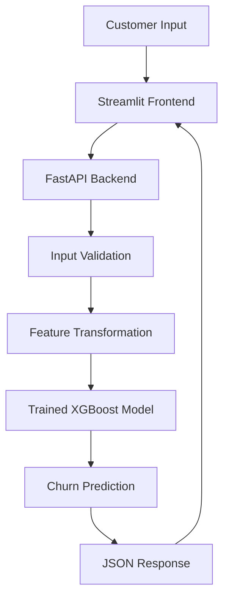

# Telco Customer Churn Prediction

An end-to-end Machine Learning application that predicts whether a telecommunications customer is likely to leave a service provider.

The project combines data preprocessing, XGBoost classification, MLflow experiment tracking, FastAPI backend development, Streamlit frontend development, and Docker-based containerization.

## Project Overview

Customer churn is a major challenge for telecommunications companies. Identifying customers who are likely to discontinue their services helps businesses take proactive customer-retention measures.

This project uses an XGBoost classification model trained on the Telco Customer Churn dataset.

Users can enter customer information through a Streamlit interface. The frontend sends the information to a FastAPI backend, which processes the input and returns a churn prediction using the trained model.

## Key Features

- Customer churn prediction using XGBoost.
- Data preprocessing and feature engineering.
- MLflow experiment tracking.
- Consistent training and inference feature ordering.
- FastAPI REST API for model serving.
- Interactive Streamlit frontend.
- Docker containerization with separate frontend and backend services.
- Swagger API documentation.
- GitHub Actions workflow for automated project checks.

## Dataset

**Dataset:** Telco Customer Churn

**File:** `src/data/raw/Telco-Customer-Churn.csv`

| Property | Value |
|---|---:|
| Rows | 7,043 |
| Columns | 21 |
| Missing values in inspected file | 0 |
| Target column | `Churn` |

The dataset contains customer demographics, service subscriptions, contract information, billing details, and churn labels.

The `Churn` column is the target variable used for classification.

Note: Confirm the original dataset source and license and include the appropriate attribution before redistribution.

## Technology Stack

| Category | Technologies |
|---|---|
| Programming | Python |
| Machine Learning | XGBoost, Scikit-learn |
| Data Processing | Pandas, NumPy |
| Experiment Tracking | MLflow |
| Backend | FastAPI |
| Frontend | Streamlit |
| API Server | Uvicorn |
| Containerization | Docker |
| Testing | Pytest |
| CI/CD | GitHub Actions |

## Application Architecture



### Prediction Workflow

1. The user enters customer information in Streamlit.
2. Streamlit sends a POST request to FastAPI.
3. FastAPI validates the customer information.
4. The inference module transforms the input into the expected feature format.
5. The trained XGBoost model generates a prediction.
6. FastAPI returns the prediction as a JSON response.
7. Streamlit displays the result.

## Project Structure

```text
Telco-Customer-Churn-ML/
│
├── .github/
│   └── workflows/
│       └── ci.yml
│
├── frontend/
│   └── streamlit_app.py
│
├── src/
│   ├── app/
│   │   └── main.py
│   │
│   ├── data/
│   │   └── raw/
│   │       └── Telco-Customer-Churn.csv
│   │
│   ├── serving/
│   │   ├── inference.py
│   │   └── model/
│   │       └── deployment_model/
│   │           ├── model.pkl
│   │           ├── MLmodel
│   │           ├── feature_columns.txt
│   │           ├── conda.yaml
│   │           ├── python_env.yaml
│   │           └── requirements.txt
│   │
│   └── utils/
│       └── validate_data.py
│
├── scripts/
│   └── run_pipeline.py
│
├── Dockerfile.api
├── dockerfile
├── .dockerignore
├── .gitignore
├── requirements.txt
├── README.md
└── CLAUDE.md
```

## Getting Started

### 1. Prerequisites

Install:

- Python 3.11
- Git
- Docker Desktop
- Visual Studio Code (recommended)

Verify:

```powershell
python --version
git --version
docker --version
```

### 2. Clone the Repository

```powershell
git clone https://github.com/YOUR-GITHUB-USERNAME/Telco-Customer-Churn-ML.git
cd Telco-Customer-Churn-ML
```

### 3. Create a Virtual Environment

```powershell
python -m venv venv
```

Activate on Windows PowerShell:

```powershell
.\venv\Scripts\Activate.ps1
```

If PowerShell blocks activation:

```powershell
Set-ExecutionPolicy -Scope Process -ExecutionPolicy Bypass
```

### 4. Install Dependencies

```powershell
python -m pip install --upgrade pip
pip install -r requirements.txt
```

## Run Locally

The application uses two separate services.

### 1. Start FastAPI

In the first terminal:

```powershell
uvicorn src.app.main:app --reload
```

FastAPI runs at:

`http://127.0.0.1:8000`

Swagger documentation:

`http://127.0.0.1:8000/docs`

### 2. Start Streamlit

Open another terminal, activate the virtual environment, and run:

```powershell
streamlit run frontend/streamlit_app.py
```

The frontend normally runs at:

`http://localhost:8501`

The frontend communicates with FastAPI through the `API_URL` environment variable. Its default local prediction endpoint is:

```text
http://127.0.0.1:8000/predict
```

## API Documentation

FastAPI provides the following endpoints:

| Method | Endpoint | Purpose |
|---|---|---|
| GET | `/` | Application root |
| GET | `/health` | Health check |
| POST | `/predict` | Customer churn prediction |
| GET | `/docs` | Swagger documentation |

### Example Prediction Request

```json
{
  "gender": "Female",
  "Partner": "Yes",
  "Dependents": "No",
  "PhoneService": "Yes",
  "MultipleLines": "No",
  "InternetService": "Fiber optic",
  "OnlineSecurity": "No",
  "OnlineBackup": "Yes",
  "DeviceProtection": "No",
  "TechSupport": "No",
  "StreamingTV": "Yes",
  "StreamingMovies": "Yes",
  "Contract": "Month-to-month",
  "PaperlessBilling": "Yes",
  "PaymentMethod": "Electronic check",
  "tenure": 1,
  "MonthlyCharges": 85.5,
  "TotalCharges": 85.5
}
```

Example response:

```json
{
  "prediction": "Likely to churn"
}
```

The prediction is a model-generated estimate, not a guarantee of customer behavior.

## Docker Deployment

The project uses two separate Docker images:

- FastAPI backend: `telco-churn-api`
- Streamlit frontend: `telco-churn-streamlit`

Both images use the GitHub-tracked model artifacts in:

```text
src/serving/model/deployment_model/
```

Inside the containers, the model is available at:

```text
/app/model
```

### 1. Build the FastAPI Image

```powershell
docker build -f Dockerfile.api -t telco-churn-api:latest .
```

### 2. Build the Streamlit Image

```powershell
docker build -f dockerfile -t telco-churn-streamlit:latest .
```

### 3. Create a Docker Network

```powershell
docker network create telco-network
```

If the network already exists, you do not need to create it again.

### 4. Start the API Container

```powershell
docker run -d --name telco-churn-api --network telco-network -p 8000:8000 telco-churn-api:latest
```

### 5. Start the Streamlit Container

```powershell
docker run -d --name telco-churn-streamlit --network telco-network -e API_URL=http://telco-churn-api:8000/predict -p 8501:8501 telco-churn-streamlit:latest
```

### 6. Access the Application

| Service | URL |
|---|---|
| Streamlit Frontend | http://localhost:8501 |
| FastAPI Backend | http://localhost:8000 |
| Swagger Documentation | http://localhost:8000/docs |
| Health Check | http://localhost:8000/health |

### 7. Verify Containers

```powershell
docker ps
```

View API logs:

```powershell
docker logs telco-churn-api
```

View Streamlit logs:

```powershell
docker logs telco-churn-streamlit
```

## Machine Learning Workflow

The project covers the following stages:

1. Data validation.
2. Data preprocessing.
3. Feature engineering.
4. XGBoost model training.
5. MLflow experiment tracking.
6. Model artifact storage.
7. Model inference through FastAPI.
8. Prediction display through Streamlit.

### Model Inference

The inference module:

- Loads the trained model.
- Loads the saved feature schema.
- Applies the serving-time feature transformations.
- Maintains the expected feature column order.
- Generates churn predictions using the trained model.

The application loads saved model artifacts rather than retraining the model for every prediction request.

## Testing

Run the automated test suite:

```powershell
python -m pytest -v
```

## CI/CD

The project includes a GitHub Actions workflow:

```text
.github/workflows/ci.yml
```

The workflow is used for automated project checks. Refer to the workflow file for its exact configured steps.

## Cloud Deployment Status

**Render deployment: Planned / In progress.**

The local application and two-container Docker architecture have been tested successfully.

The next deployment phase is:

```text
GitHub → Render FastAPI Service → Render Streamlit Service
```

Cloud deployment should only be marked complete after both services are publicly accessible and the frontend successfully communicates with the deployed API.

## Security and Configuration

- Do not commit passwords, API keys, or secret environment variables.
- Keep private customer information out of public repositories.
- Verify dataset licensing and attribution before redistribution.
- Store deployment secrets in the hosting platform's environment settings.
- Validate user input before model inference.
- Only load trusted model artifacts.

## Future Improvements

- Complete Render deployment.
- Add structured application logging.
- Improve test coverage.
- Add model performance monitoring.
- Add prediction confidence and explainability.
- Improve API error handling.
- Explore cloud deployment alternatives.

## Author

**Satyam Singh**

BCA – Data Science | Chandigarh University

Aspiring Machine Learning Engineer | AI Engineer

Interested in Machine Learning, Generative AI, and production-oriented AI applications.

- GitHub: https://github.com/Student-Satyam
- LinkedIn: https://www.linkedin.com/in/satyam-singh-328a5336b/

---

This project is developed for educational and practical machine learning engineering purposes.
